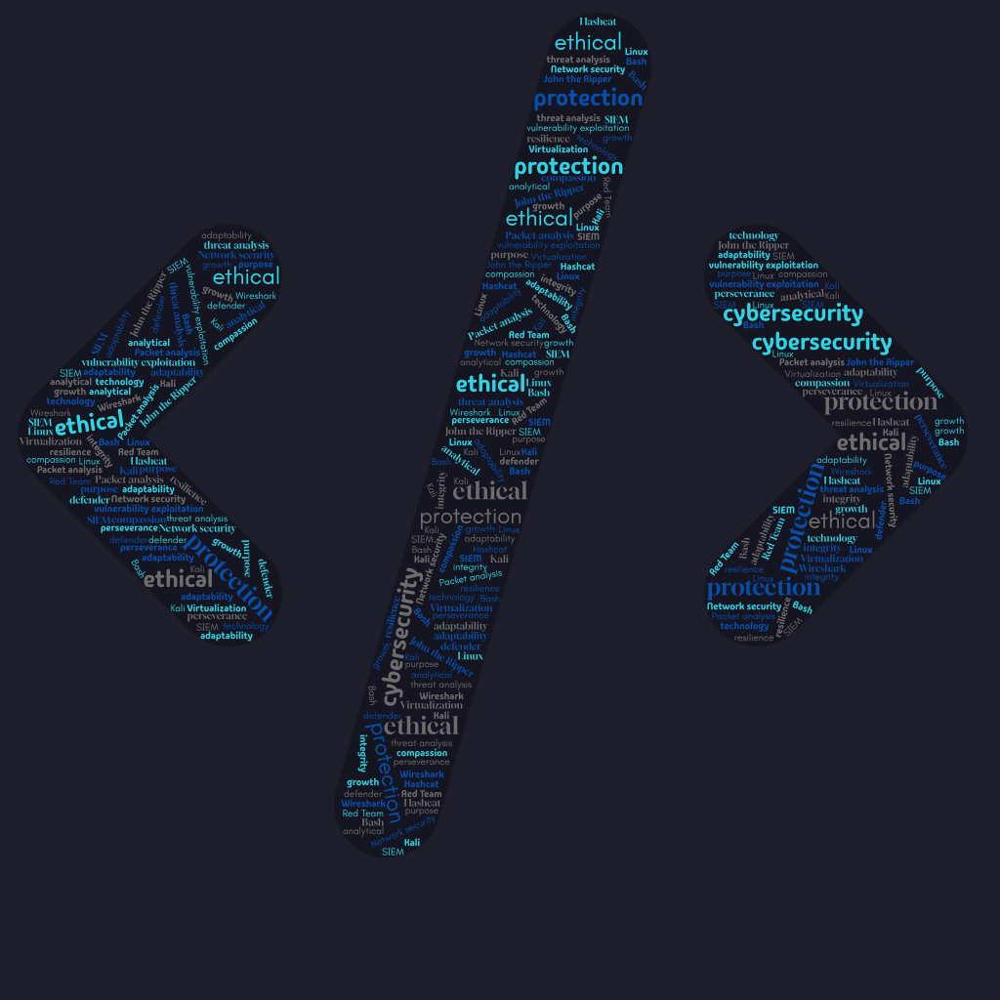



## About Me
Hello! I'm Mai Nguyen, a sophomore at Houston City College, studying Computer Systems Networking - Cybersecurity Specialization. I’ve always had a passion for helping people, which is why I originally dreamed of becoming a surgeon. Along the way, I developed a love for computers that started as a hobby and grew into something more, eventually leading me to change course and pursue a career in technology. Cybersecurity brings my two passions together: it lets me use technology to protect people and help keep their information safe. I’m excited to keep building my skills and to start a career defending others from cyber threats.

## Organizations
- HCC Computer Science Association 

## Competitions, Challenges, Conferences & Workshops
- **NCL (National Cyber League)** – 2026
- **XP Cyber Range Challenges** 

## Work Experience
- **[Job Title]**, [Company] – [Dates]: [what you did]

## Career Goal
[1–2 sentences]

## My Role Model
**[Name]** – [who they are]

> "[Their quote]"
> — [Name]

[2–3 sentences on how they've impacted you.]

## Word Cloud

